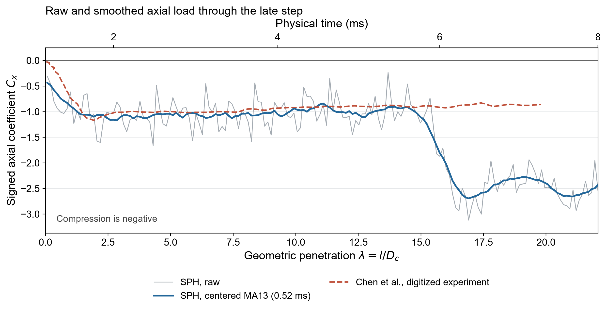
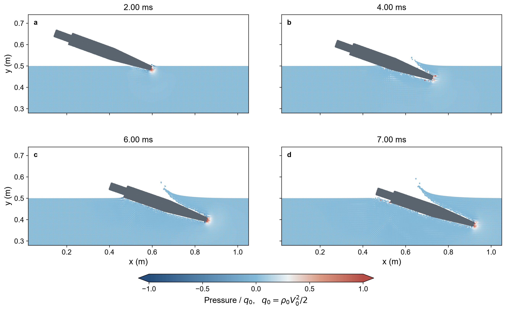

# A late-stage axial-force step in a 3D SPH oblique water-entry simulation

While reviewing my three-dimensional oblique water-entry results, I noticed an abrupt increase in axial drag magnitude near a dimensionless penetration distance of 16. The magnitude then remained above the experimental reference curve. This change is already present in the unfiltered sampled output and becomes a clear step after smoothing. This note brings together the simulation conditions, load curves and corresponding water-entry snapshots to document the observation.

## 1. Simulation conditions

The simulation uses an M1 projectile with a disk cavitator. Its main body is 479.6 mm long, with a maximum diameter of 58.5 mm; the cavitator diameter is 21.1 mm.

| Parameter | Setting |
|---|---|
| Water-entry environment | Still water; single-liquid-phase weakly compressible smoothed particle hydrodynamics (SPH) |
| Initial speed | 70 m/s |
| Nominal entry angle | 20° |
| Artificial speed of sound | 700 m/s |
| Fluid particle spacing | 5 mm |
| Nominal solid particle spacing | 2.5 mm |
| Wetting parameter | γ = 25; the diffusion coefficient is set to γ times the square of the reference particle spacing |
| Rigid-body motion | Three-dimensional flow field; in-plane translation and rotation about the z-axis |
| Time interval shown | 0-8 ms |

The dimensionless penetration distance is λ = l/Dc, where Dc is the cavitator diameter. The distance l is the accumulated rigid-body displacement along the projectile's initial axis, measured from first contact between the cavitator's lower edge and the nominal still-water surface. Geometric first contact occurs at approximately 1.178 ms in this case. The axial force is projected onto the instantaneous projectile axis, with compressive drag taken as negative.

## 2. The step in the load history

<figure>

<figcaption>Figure 1. The gray line is the unfiltered sampled axial-force coefficient. The blue line is a 13-point centered moving average, with a discrete window of 0.52 ms. The red dashed line is a digitized reference from the experimental curve of Chen et al. at 20° and 70 m/s. The upper axis shows simulation physical time.</figcaption>
</figure>

Within the early-time window, the peak of the smoothed simulation curve occurs at λ = 2.854. The corresponding peak location in the literature table is 1.85. The simulated peak therefore occurs at a penetration distance approximately 54.3% greater than the reference value. The simulated drag then stays near Cx = -1 over part of the entry distance.

Near λ = 16, the simulated curve drops rapidly, and the drag magnitude rises to more than twice its preceding level. In the saved later portion, the smoothed curve lies roughly between Cx = -2.3 and -2.7. The digitized experimental reference remains near Cx = -1. The same change is also visible in the unfiltered sampled curve.

## 3. The corresponding water-entry sequence

<figure>

<figcaption>Figure 2. Water-entry snapshots at 2, 4, 6 and 7 ms, showing a thin central slice near z = 0.2 m. The dimensionless pressure is p/q0, where q0 = ρ0V02/2.</figcaption>
</figure>

At 2 ms, the cavitator has entered the water, while most of the projectile body remains above the surface. By 4 ms, the immersed portion extends farther back, and the water surface near the projectile begins to deform visibly. The 6 and 7 ms snapshots span the formation of the load step. The rear of the projectile gradually approaches and enters the region near the deformed water surface.

The observation to explain is the rapid increase in axial drag as the projectile continues to enter the water, followed by sustained separation from the experimental reference.

## Source code

[Organized 3D code](https://github.com/SiyuZou927/SPHinXsys-Siyu-Zou/tree/b657f4870c1617c3e1e4cffa56b307812ccd9e36/tests/3d_examples/test_3d_zsy_oblique_water_entry_exit) (commit `b657f48`). Main simulation file: [test_3d_water_entry_exit.cpp](https://github.com/SiyuZou927/SPHinXsys-Siyu-Zou/blob/b657f4870c1617c3e1e4cffa56b307812ccd9e36/tests/3d_examples/test_3d_zsy_oblique_water_entry_exit/test_3d_water_entry_exit.cpp).

Experimental reference: [Chen et al. (2019)](https://doi.org/10.1016/j.ijnaoe.2018.09.002).
